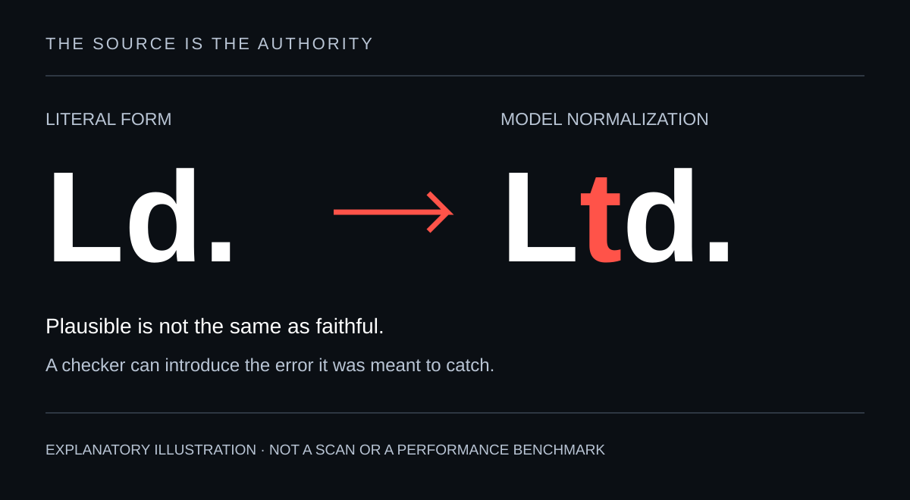
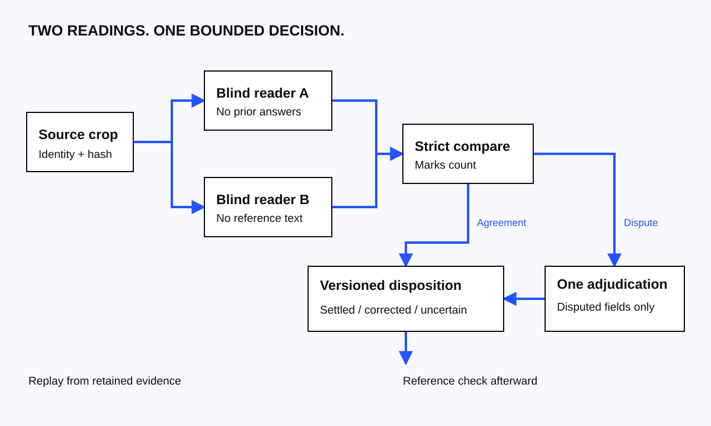

# Hong Kong Jurors List Harness

I wanted to follow my family through British colonial Hong Kong records. The juror lists seemed like a good place to start: year after year of printed names, occupations, and addresses, offering clues about where people lived and worked.

The task looked straightforward. Read the pages, extract the rows, and follow people across years. Then models started improving the spelling, addresses landed against the wrong names, and agreement between two model readers turned out to be less reassuring than it sounded.

This repository contains the Python software I built to make that work more dependable. It is a **transcription harness**: a workflow around the models that controls what they read, compares their answers, preserves the evidence, and leaves uncertainty visible.

Read the [Impresa case study](https://impresa.com/work/hong-kong-jurors-list-harness) for the family-history question that started the project, examples from the original scans, and what the experiments taught me.

The aim is **diplomatic transcription**—preserving what the source actually says, including unusual spellings, abbreviations, and punctuation. A corrected spelling may help a search. It should not silently replace the historical record.

## Why these lists—and why the details matter

The Hong Kong Jurors Lists recorded men eligible for jury service. The series spans 88 years, from 1854 to 1941. Our working reference inventory contains roughly 98,000 annual entries across 87 retrieved years: a provisional inventory, not a verified source census or a count of unique people.

For my Apcar family research, those recurring entries offer a way to trace people, employers, and addresses over time. But an entry can span several lines, and the relationship between columns matters as much as the words. Reading an address correctly is little help if it ends up attached to the wrong person.

Some examples from selected checks:

| What happened | Why it matters |
|---|---|
| Haiku expanded printed `Ld.` to `Ltd.` | One added letter turned the source abbreviation into a more familiar one. |
| Flash changed printed `Shamsuipo` to `Shamshuipo` | A useful search spelling replaced the literal reading. |
| A local OCR configuration assigned an address to another person | Correctly read words became an incorrect record. |

These are documented examples, not a model leaderboard or an estimate of error rates. They show the kinds of mistakes the workflow needs to expose. [The experiments and their limits](docs/MODEL-JOURNEY.md).



## From better prompts to a repeatable workflow

So I kept tinkering. I tried different optical character recognition (OCR) tools, local models, hosted readers, stricter prompts, and repaired image crops. Some changes helped. Others introduced new problems. Getting useful text was relatively easy; knowing what I could trust took more engineering.

This became an exercise in **custom harness engineering**: giving the checking process a defined sequence and rules the software could enforce. Two model readers independently transcribe the source. Neither sees the other’s answer or the reference transcription. The software then compares their output strictly, including punctuation and accents.

Unresolved fields receive one adjudication pass, which can inspect the source and the competing readings. If the evidence still does not support a decision, the result remains uncertain. Reference text enters only after those readings and decisions, as a separate cross-check.



The engineering around that sequence serves four purposes:

- **Keep the evidence:** source hashes, versioned prompts, separate readings, and traceable decisions.
- **Apply consistent checks:** literal comparison, with reference text kept out of the initial reading and decision stages.
- **Control spending:** stage budgets, cost reservations before calls, a global billing stop, and explicit handling of unknown charges.
- **Recover reliably:** caching tied to the request, interruption recovery, and byte-for-byte replay of released results.

Python controls the sequence and the configured model routes. Models do not choose tools or launch agents. General-purpose AI tools helped me build and investigate; the repeating transcription job needed rules the software could enforce.

Some of the most useful work came from finding gaps in those rules. A cached answer must match the full material request that produced it: the relevant inputs, prompts, candidates, and model settings, not credentials or incidental attempt identifiers. A saved release must refuse changed context instead of returning stale output. If a call is interrupted and its outcome is unknown, its cost reservation must remain in place rather than quietly allowing another dispatch.

Those failure paths now have [offline regression tests](tests/test_material_cache.py). The [repair notes](docs/devlog/2026-11-08-local-acceptance-mechanics.md) record what failed and what changed.

## What has been demonstrated

The first acceptance case asked a practical question: could the harness take an existing body of transcription work, preserve its readings and decisions, and reproduce its releases without contacting a model again?

**The 1940 case passed that test.** It migrated 3,505 pilot entries using retained historical evidence and reproduced both releases with networking blocked. The exercise made no new paid transcription calls; the earlier readings still had their original costs. Five selected real-source cases also exercised comparison, decisions, and release construction using retained evidence, and an interrupted import resumed cleanly.

The retained edition records **3,058 settled, 84 corrected, and 363 uncertain entries**. Those are workflow outcomes, not independently verified accuracy labels. The 33 page-1 Special entries remain excluded, full original request settings are missing for 6,547 imported readings, and there are no independent human labels establishing the true error rate.

The result demonstrates migration, preservation, and replay. It does not establish perfect transcription or a complete year. Earlier work also produced local 1906 and 1908 editions under different workflows. [Acceptance evidence and limits](docs/ACCEPTANCE-1940.md).

**59 offline tests pass.** This repository includes the code, original diagrams, and synthetic fixtures. It excludes the private historical corpus, so the historical acceptance case cannot be independently reproduced from this repository alone. The synthetic demo below provides a way to exercise the workflow yourself.

## Try it without an API key

You need Python 3.11 or later. Runtime dependencies are limited to the standard library. From the checkout:

```bash
export JURORS_HARNESS_AUTHORIZE=synthetic-1939-demo
python -m jurors_harness run \
  --config configs/examples/synthetic-year.json \
  --work runs/synthetic-1939-demo
```

Start by opening `runs/synthetic-1939-demo/` to inspect the demo output. The [usage guide](https://github.com/apcar/HKJurorsListHarness/blob/main/docs/USAGE.md#replay) shows how to verify and replay the release offline.

The demo uses scripted provider responses: no network calls or paid inference. Names are invented, images are color blocks, and ledger costs are simulated. It exercises the workflow, not OCR quality.

The [usage guide](docs/USAGE.md) covers installation, inputs, budgets, resuming interrupted work, and replay.

## Why this may be useful beyond family history

The problem extends beyond historical lists. In invoices, contracts, and personal records, correctly extracted words can still be attached to the wrong person, party, or transaction. A fluent answer can conceal a structural error.

That is the case for **custom harness engineering**: giving a repeated task’s rules somewhere to live beyond a prompt. Models can change while evidence requirements, spending limits, and acceptance checks remain explicit and inspectable.

This project explores that approach through one specific task. It remains experimental; it does not establish production readiness for other document domains.

## What comes next

I’m working toward a second real year through the harness, stronger review of weak evidence, and a test on an unseen layout. The measure I care about is total cost per accepted entry, including checking and repair. [Roadmap](docs/ROADMAP.md).

I set the research question, source standards, workflow, and acceptance criteria. AI coding and review agents helped implement, test, and challenge the software. The development history retains their contribution and the repairs. I’m sharing the working artifact, including where it still falls short.

[Pipeline](docs/PIPELINE.md) · [Policies](docs/POLICIES.md) · [Cost ledger](docs/LEDGER.md) · [Development notes](docs/devlog/) · [Contributing](CONTRIBUTING.md) · [More of my work](https://impresa.com/)

## Credits and license

This work builds on a substantial contribution by **David Bellis and the Gwulo community**. From July 2010 to June 2026, volunteers typed 1,769 pages covering the 1854–1941 series, making difficult-to-search scans searchable.

The [completion account](https://gwulo.com/node/62380) acknowledges 61 contributor names and usernames. Bellis notes that the formats are mixed and the list may be incomplete, so this is an acknowledgment count rather than a verified count of distinct volunteers.

Their nearly 16-year effort began long before today’s widely accessible AI tools. It made these records useful to researchers and helped me understand what was worth attempting. HKU Libraries supplied the scans that enabled both projects.

Here, Gwulo’s transcription serves as a cross-check after the source readings and decisions. It is not redistributed, and no endorsement is implied.

The [MIT license](LICENSE) covers the software, original documentation, and synthetic fixtures. Historical scans, family photographs, reference text, and private run evidence are excluded. [Data notice](DATA-NOTICE.md).
